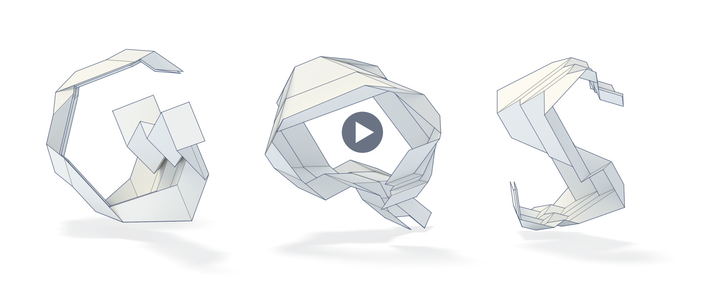

# Generalized quasi-symmetric nets (GQS-nets): notebooks, code, data, and video

A. Nurmatov, F. Rist, J. Klein, and D. L. Michels

This repository holds the notebooks, code, data, and video of the paper *Generalized Quasi-Symmetric Nets: A
Constructive Approach to the Equimodular Elliptic Type and to Flexible m × n Nets*.

## Video

[](https://nurmaton.github.io/gqs-nets/Video/gqs.mp4)

## Contents

| File | Content |
|---|---|
| [`helper.nb`](helper.nb) ([PDF](helper.pdf)) | Mathematica notebook that verifies the symbolic computations of the proofs |
| [`ehelper.nb`](ehelper.nb) ([PDF](ehelper.pdf)) | Mathematica notebook that verifies the computations behind the $`m \times n`$ nets |
| [`gqs.py`](gqs.py) | Python tool that constructs $`m \times n`$ nets, shows their motion, and checks them numerically |
| [`parameters.txt`](parameters.txt) | `gqs.py` settings for the digits, letters, and animals |
| [`Application/`](Application/README.md) | Three transportable arch halls built from these nets |
| [`Prototype/`](Prototype/README.md) | A 1:20 physical model of the arch hall (ii) that folds by hand |
| [`Video/`](Video/README.md) | The video (`gqs.mp4`) and its narration (`narration.txt`) |

## Requirements and use

**Notebooks:** written with Mathematica 14.0; the PDF copies show them with their results.

**gqs.py:** Python 3 with numpy 1.20 or newer and matplotlib 3.7 or newer.

```
python3 gqs.py            # opens the interactive window
python3 gqs.py --frames   # saves six frames of the flexion without a window
python3 gqs.py --help     # lists the options
```

**Application:** Python 3 with numpy, scipy, and matplotlib; optionally CalculiX and Blender.

```
sh Application/run_quick.sh
```

## AI assistance

The code was written or revised with the assistance of the Claude models Opus 5, Opus 5.5, Fable 5, and Fable 5.1 (Anthropic).
The files of `Prototype/` and the video were made with the assistance of the Claude model Opus 5.5 (Anthropic), and the
narration of the video was generated with Gemini 3.8 Flash TTS (Google). The authors checked all files.

## License

The repository is licensed under the MIT License; see [`LICENSE`](LICENSE). The third-party material in the video keeps its own
terms; see [`Video/README.md`](Video/README.md).
