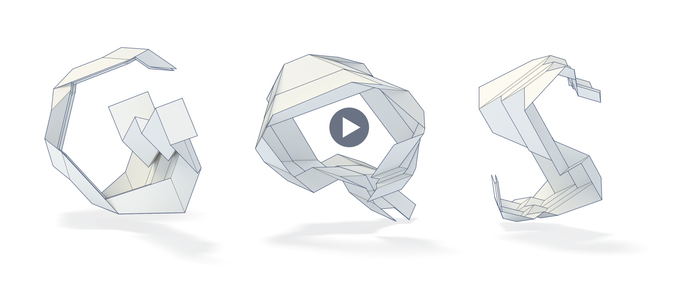

# Video

A short summary of the paper that shows the nets and the 1:20 physical model in motion. GitHub cannot play `gqs.mp4`;
the picture above opens it in the browser. Its narration is [`narration.txt`](narration.txt), one sentence per line.

## Third-party material

The video contains the following material, which keeps its own terms.

| In the video | Source | Terms; changes |
|---|---|---|
| NASA / Glenn Benson 2024 | NASA / Glenn Benson, Kennedy Space Center: [Europa Clipper solar array deployment test](https://images.nasa.gov/details/KSC-20240821-MH-GEB01-0001-Europa_Clipper_Solar_Array_Deployment_PHSF-M8663), 2024 | Public domain; trimmed, cropped, sped up |
| Overvelde et al. 2016 | J. T. B. Overvelde et al., [Nature Communications 7 (2016), 10929](https://doi.org/10.1038/ncomms10929), Supplementary Movie 1, via Wikimedia Commons | [CC BY 4.0](https://creativecommons.org/licenses/by/4.0/); trimmed |
| Iniguez-Rabago et al. 2019 | A. Iniguez-Rabago, Y. Li, J. T. B. Overvelde, [Nature Communications 10 (2019), 5577](https://doi.org/10.1038/s41467-019-13319-7), Supplementary Movie 3 | CC BY 4.0; trimmed |
| Pinson et al. 2017 | M. B. Pinson et al., [Nature Communications 8 (2017), 15477](https://doi.org/10.1038/ncomms15477), Supplementary Movie 3, via Wikimedia Commons | CC BY 4.0; trimmed |
| Jamalimehr et al. 2022 | A. Jamalimehr et al., [Nature Communications 13 (2022), 1816](https://doi.org/10.1038/s41467-022-29484-1), Supplementary Movie 2 | CC BY 4.0; trimmed, cropped |
| Wang et al. 2023 | L. Wang et al., [Nature Communications 14 (2023), 8516](https://doi.org/10.1038/s41467-023-44303-x), Supplementary Movie 2 | CC BY 4.0; trimmed, cropped, sped up; its blank paper continued sideways |
| The Stanford bunny | Stanford Computer Graphics Laboratory, [The Stanford 3D Scanning Repository](https://graphics.stanford.edu/data/3Dscanrep/) | The repository's terms; its side silhouette only |
| Blub | K. Crane, [Keenan's 3D Model Repository](https://www.cs.cmu.edu/~kmcrane/Projects/ModelRepository/) | Public domain (CC0); its side silhouette only |
| The KAUST symbol | King Abdullah University of Science and Technology | Belongs to KAUST; redrawn and animated, without the lettering |
